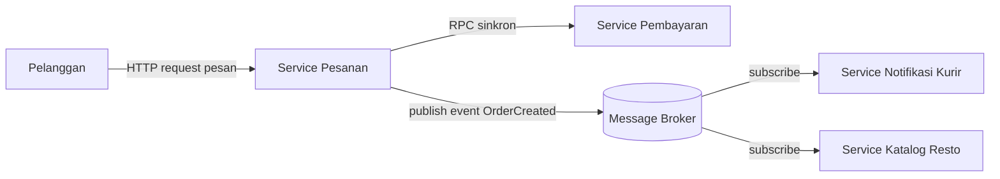
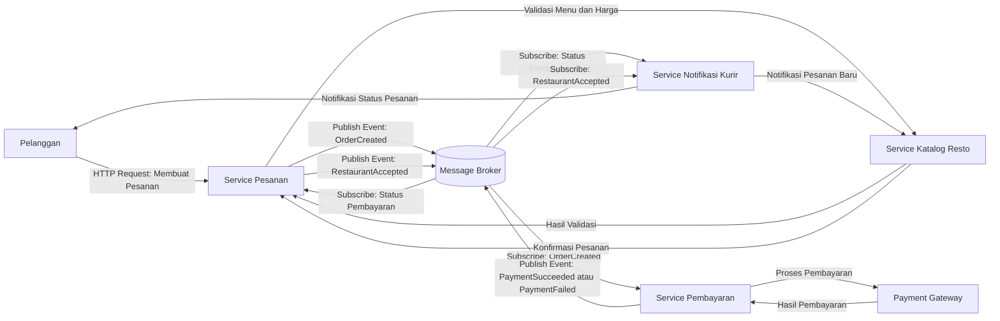

# Tugas 2 (Pekan 2) — Perancangan Arsitektur untuk FoodGo

**Materi terkait:** Architectural style (Layered, SOA, Peer-to-Peer, Publish-Subscribe).

## Studi Kasus

Melanjutkan Tugas 1: FoodGo butuh sistem yang **decoupled** agar tim kurir dan tim resto tidak saling mengganggu ketika salah satu modul diperbarui/deploy ulang. Saat ini semua modul (pesanan, pembayaran, notifikasi kurir, katalog resto) berjalan sebagai satu aplikasi monolitik — sekali deploy, semua modul ikut restart dan berisiko downtime total.

## Tugas Kelompok

1. Pilih **satu** gaya arsitektur utama: **Service-Oriented Architecture (SOA)** atau **Publish-Subscribe**. Boleh dikombinasikan (mis. SOA untuk service inti + Pub-Sub untuk notifikasi), tapi harus dijustifikasi kenapa kombinasi ini yang dipilih.
2. Gambarkan minimal 4 komponen berikut dan interaksinya: modul Pesanan, modul Pembayaran, modul Kurir/Notifikasi, modul Katalog Resto (dan message broker/API gateway jika relevan).
3. Jelaskan alur satu skenario penuh secara end-to-end di diagram (misalnya: pelanggan buat pesanan → bayar → resto terima notifikasi → kurir ditugaskan) — tunjukkan komponen mana berkomunikasi dengan siapa, dan **jenis komunikasinya** (sinkron/asinkron, request-response/event).
4. Analisis tertulis: kenapa gaya ini mengatasi masalah *coupling* dari Tugas 1, dan apa trade-off-nya (mis. Pub-Sub menambah kompleksitas debugging karena alur tidak linear).

## Cara Membuat Diagram (Gratis, Cukup Laptop)

Tidak perlu software berbayar. Dua opsi:

**Opsi A — Mermaid di dalam Markdown (disarankan).** Ditulis sebagai teks biasa di `README.md`, otomatis dirender jadi diagram oleh GitHub — tidak perlu install apa pun.

````markdown

````

**Opsi B — draw.io / diagrams.net** (gratis, jalan di browser tanpa akun, atau app desktop offline di [app.diagrams.net](https://app.diagrams.net/)). Ekspor sebagai `.png` dan simpan di folder `diagram/`.

## Struktur Submission

```
tugas-02-perancangan-arsitektur/
├── README.md          # Analisis + diagram Mermaid (jika Opsi A) atau referensi ke diagram/
├── JURNAL.md
└── diagram/            # File .png/.drawio jika pakai Opsi B
```

## Rubrik Penilaian (Tugas 2)

| Komponen | Bobot | Kriteria |
|---|---|---|
| Ketepatan pemilihan gaya arsitektur | 20% | Justifikasi SOA/Pub-Sub sesuai kebutuhan *decoupling* di skenario |
| Kelengkapan & kejelasan diagram | 30% | Semua komponen kunci ada, jenis komunikasi (sinkron/asinkron) jelas ditandai |
| Analisis trade-off | 30% | Bukan hanya kelebihan — kekurangan/kompleksitas baru juga dibahas |
| Proses & kontribusi kelompok | 20% | `JURNAL.md`, commit history |

## Batasan Penggunaan AI (Level 2)

Kebijakan **Level 2 (AI Assisted Idea Generation & Structuring)** berlaku — lihat [`../RUBRIK-UMUM.md`](../RUBRIK-UMUM.md). Boleh memakai AI untuk brainstorming komponen apa saja yang umum ada di gaya arsitektur SOA/Pub-Sub; **tidak boleh** meminta AI menggambar diagram final atau menuliskan analisis trade-off yang tinggal ditempel. Catat pemakaian AI di "Log Penggunaan AI" pada `JURNAL.md`.

- Diagram Mermaid/draw.io yang "terlalu generik" (identik dengan contoh tutorial di internet tanpa penyesuaian ke kasus FoodGo) akan dinilai rendah pada komponen kelengkapan & kejelasan diagram.


## 1. Pemilihan Gaya Arsitektur

FoodGo menggunakan kombinasi Service-Oriented Architecture (SOA) dan Publish-Subscribe untuk membuat sistem yang lebih terpisah dan tidak saling bergantung. Dengan SOA, fungsi utama FoodGo dibagi menjadi beberapa layanan, seperti modul Pesanan, Pembayaran, Kurir/Notifikasi, dan Katalog Resto, sehingga setiap layanan bisa dikembangkan, diperbarui, dan di-deploy secara mandiri. Sementara itu, Publish-Subscribe digunakan agar komunikasi antarlayanan bisa dilakukan melalui event yang dikirim menggunakan *message broker*. Kombinasi ini dipilih karena komunikasi yang membutuhkan respons langsung, seperti validasi menu, dapat menggunakan metode sinkron, sedangkan proses yang tidak harus langsung mendapatkan respons, seperti pengiriman notifikasi dan pembaruan status pesanan, dapat menggunakan metode asinkron. Dengan begitu, sistem FoodGo menjadi lebih fleksibel, mudah dikembangkan, dan tidak terlalu bergantung pada satu layanan saja.

## 2. Diagram Arsitektur dan Interaksi Komponen

Diagram berikut menggambarkan bagaimana setiap komponen dalam sistem FoodGo saling berinteraksi, mulai dari pelanggan membuat pesanan sampai proses pembayaran dan pengiriman notifikasi. Setiap layanan memiliki tugas masing-masing, sehingga tidak semua proses harus dilakukan secara langsung. Untuk komunikasi yang membutuhkan respons cepat, seperti validasi menu dan harga, digunakan komunikasi sinkron. Sementara itu, untuk proses seperti pengiriman informasi pesanan dan pembaruan status pembayaran, digunakan pola Publish-Subscribe melalui *message broker*.



**Keterangan:**

- Pelanggan: Mengirim permintaan untuk membuat pesanan melalui sistem FoodGo.
- Service Pesanan: Mengelola pesanan, mulai dari proses pembuatan sampai perubahan status pesanan.
- Service Pembayaran: Memproses pembayaran pelanggan melalui Payment Gateway dan mengirimkan hasilnya melalui event.
- Service Katalog Resto: Menyediakan informasi menu, harga, dan ketersediaan menu, serta mendukung proses konfirmasi pesanan dari restoran.
- Service Notifikasi Kurir: Mengirimkan informasi status pesanan kepada pelanggan dan restoran, serta mendukung proses penugasan kurir.
- Message Broker: Menjadi perantara untuk menyampaikan event dari layanan yang mengirimkan informasi ke layanan yang berlangganan

Melalui arsitektur ini, FoodGo dapat memisahkan komunikasi yang membutuhkan respons langsung dengan komunikasi berbasis event. Dengan begitu, setiap layanan bisa menjalankan tugasnya masing-masing tanpa harus selalu berkomunikasi secara langsung dengan layanan lainnya. Hal ini juga membantu mengurangi ketergantungan antarlayanan sehingga sistem lebih mudah dikembangkan dan dipelihara.
