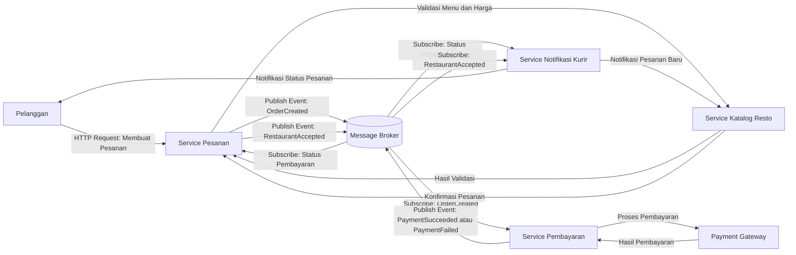
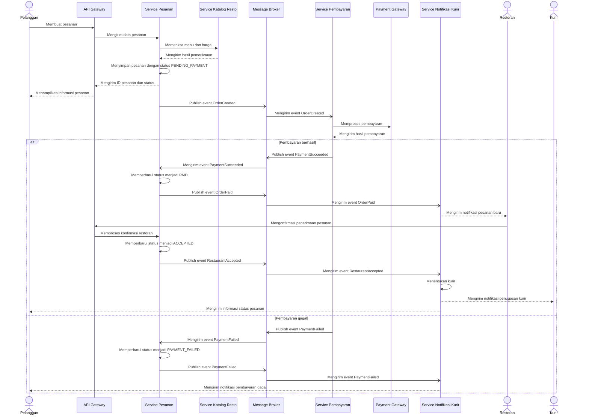

# Tugas 2 (Pekan 2) — Perancangan Arsitektur untuk FoodGo

**Materi terkait:** Architectural style (Layered, SOA, Peer-to-Peer, Publish-Subscribe).

## Studi Kasus

Melanjutkan Tugas 1: FoodGo butuh sistem yang **decoupled** agar tim kurir dan tim resto tidak saling mengganggu ketika salah satu modul diperbarui/deploy ulang. Saat ini semua modul (pesanan, pembayaran, notifikasi kurir, katalog resto) berjalan sebagai satu aplikasi monolitik — sekali deploy, semua modul ikut restart dan berisiko downtime total.

## Tugas Kelompok

1. Pilih **satu** gaya arsitektur utama: **Service-Oriented Architecture (SOA)** atau **Publish-Subscribe**. Boleh dikombinasikan (mis. SOA untuk service inti + Pub-Sub untuk notifikasi), tapi harus dijustifikasi kenapa kombinasi ini yang dipilih.
2. Gambarkan minimal 4 komponen berikut dan interaksinya: modul Pesanan, modul Pembayaran, modul Kurir/Notifikasi, modul Katalog Resto (dan message broker/API gateway jika relevan).
3. Jelaskan alur satu skenario penuh secara end-to-end di diagram (misalnya: pelanggan buat pesanan → bayar → resto terima notifikasi → kurir ditugaskan) — tunjukkan komponen mana berkomunikasi dengan siapa, dan **jenis komunikasinya** (sinkron/asinkron, request-response/event).
4. Analisis tertulis: kenapa gaya ini mengatasi masalah *coupling* dari Tugas 1, dan apa trade-off-nya (mis. Pub-Sub menambah kompleksitas debugging karena alur tidak linear).

# Jawaban
## 1. Pemilihan Gaya Arsitektur

FoodGo menggunakan kombinasi Service-Oriented Architecture (SOA) dan Publish-Subscribe untuk membuat sistem yang lebih terpisah dan tidak saling bergantung. Dengan SOA, fungsi utama FoodGo dibagi menjadi beberapa layanan, seperti modul Pesanan, Pembayaran, Kurir/Notifikasi, dan Katalog Resto, sehingga setiap layanan bisa dikembangkan, diperbarui, dan di-deploy secara mandiri. Sementara itu, Publish-Subscribe digunakan agar komunikasi antarlayanan bisa dilakukan melalui event yang dikirim menggunakan *message broker*. Kombinasi ini dipilih karena komunikasi yang membutuhkan respons langsung, seperti validasi menu, dapat menggunakan metode sinkron, sedangkan proses yang tidak harus langsung mendapatkan respons, seperti pengiriman notifikasi dan pembaruan status pesanan, dapat menggunakan metode asinkron. Dengan begitu, sistem FoodGo menjadi lebih fleksibel, mudah dikembangkan, dan tidak terlalu bergantung pada satu layanan saja.

## 2. Diagram Arsitektur dan Interaksi Komponen

Diagram berikut menggambarkan bagaimana setiap komponen dalam sistem FoodGo saling berinteraksi, mulai dari pelanggan membuat pesanan sampai proses pembayaran dan pengiriman notifikasi. Setiap layanan memiliki tugas masing-masing, sehingga tidak semua proses harus dilakukan secara langsung. Untuk komunikasi yang membutuhkan respons cepat, seperti validasi menu dan harga, digunakan komunikasi sinkron. Sementara itu, untuk proses seperti pengiriman informasi pesanan dan pembaruan status pembayaran, digunakan pola Publish-Subscribe melalui message broker.

**Keterangan:**

- Pelanggan: Mengirim permintaan untuk membuat pesanan melalui sistem FoodGo.
- Service Pesanan: Mengelola pesanan, mulai dari proses pembuatan sampai perubahan status pesanan.
- Service Pembayaran: Memproses pembayaran pelanggan melalui Payment Gateway dan mengirimkan hasilnya melalui event.
- Service Katalog Resto: Menyediakan informasi menu, harga, dan ketersediaan menu, serta mendukung proses konfirmasi pesanan dari restoran.
- Service Notifikasi Kurir: Mengirimkan informasi status pesanan kepada pelanggan dan restoran, serta mendukung proses penugasan kurir.
- Message Broker: Menjadi perantara untuk menyampaikan event dari layanan yang mengirimkan informasi ke layanan yang berlangganan

## 3. Diagram Alur End-to-End

Proses pemesanan FoodGo dimulai dari pelanggan membuat pesanan, melakukan pembayaran, hingga restoran menerima pesanan dan kurir ditugaskan untuk mengantarkannya. Komunikasi sinkron digunakan untuk pengecekan menu dan harga yang membutuhkan respons langsung, sedangkan komunikasi asinkron digunakan untuk mengirimkan informasi melalui message broker, seperti hasil pembayaran dan perubahan status pesanan.

## Penjelasan Alur Komunikasi

| Tahap | Komunikasi | Jenis | Penjelasan |
|---|---|---|---|
| 1. Membuat pesanan | Pelanggan → API Gateway → Service Pesanan | Sinkron, request-response | Pelanggan mengirim permintaan pembuatan pesanan dan menerima informasi pesanan. |
| 2. Validasi katalog | Service Pesanan ↔ Service Katalog Resto | Sinkron, request-response | Sistem memeriksa menu, harga, dan ketersediaan sebelum pesanan diproses lebih lanjut. |
| 3. Memulai pembayaran | Service Pesanan → Message Broker → Service Pembayaran | Asinkron, event | Service Pesanan mengirim event `OrderCreated` agar Service Pembayaran dapat memulai proses pembayaran. |
| 4. Memproses pembayaran | Service Pembayaran ↔ Payment Gateway | Sinkron, request-response | Service Pembayaran mengirim permintaan pembayaran dan menerima hasilnya. |
| 5. Memperbarui status pembayaran | Service Pembayaran → Message Broker → Service Pesanan | Asinkron, event | Event `PaymentSucceeded` atau `PaymentFailed` digunakan untuk memperbarui status pesanan. |
| 6. Memberi tahu restoran | Service Pesanan → Message Broker → Service Notifikasi Kurir → Restoran | Asinkron, event | Setelah pembayaran berhasil, restoran mendapatkan notifikasi pesanan baru. |
| 7. Konfirmasi restoran | Restoran → API Gateway → Service Pesanan | Sinkron, request-response | Restoran mengonfirmasi apakah pesanan dapat diterima dan diproses. |
| 8. Penugasan kurir | Service Pesanan → Message Broker → Service Notifikasi Kurir → Kurir | Asinkron, event | Setelah restoran menerima pesanan, sistem memproses penugasan kurir dan mengirimkan notifikasi kepada kurir serta pelanggan. |

## Analisis Alur Komunikasi

Pada alur komunikasi FoodGo, komunikasi sinkron digunakan untuk proses yang membutuhkan respons langsung, seperti pengecekan menu dan harga serta konfirmasi pesanan dari restoran. Sementara itu, komunikasi asinkron digunakan untuk mengirimkan informasi melalui message broker, misalnya hasil pembayaran dan perubahan status pesanan. Dengan menggunakan Publish-Subscribe, setiap layanan tidak harus berkomunikasi secara langsung dengan layanan lainnya untuk menyampaikan informasi. Sebagai contoh, ketika pembayaran berhasil, Service Pembayaran akan mengirimkan event yang nantinya diproses oleh Service Pesanan untuk memperbarui status pesanan dan Service Notifikasi Kurir untuk memberikan informasi kepada pihak terkait. Dengan cara ini, ketergantungan antarlayanan bisa dikurangi sehingga sistem FoodGo lebih mudah dikembangkan dan dikelola. Namun, sistem tetap perlu menangani kemungkinan keterlambatan pengiriman event, event yang diterima lebih dari sekali, atau kegagalan komunikasi agar proses pemesanan tetap berjalan dengan baik.

## 4. Analisis Tertulis

Kombinasi SOA dan Publish-Subscribe dapat mengatasi masalah coupling pada sistem FoodGo dengan memisahkan fungsi aplikasi menjadi beberapa layanan yang dapat berjalan dan dikembangkan secara mandiri. Dengan begitu, perubahan pada satu layanan tidak harus mengubah layanan lainnya, selama komunikasi yang digunakan tetap sesuai. Misalnya, ketika layanan Pembayaran diperbarui, layanan Pesanan tidak perlu ikut diubah selama API dan format event yang digunakan tidak berubah. Selain itu, Publish-Subscribe memungkinkan layanan saling bertukar informasi melalui message broker tanpa harus berkomunikasi secara langsung. Contohnya, ketika pembayaran berhasil, layanan Pembayaran mengirimkan event yang dapat diterima oleh layanan Pesanan untuk memperbarui status dan layanan Notifikasi untuk memberi informasi kepada pelanggan. Dengan cara ini, ketergantungan antarlayanan dapat dikurangi sehingga pengembangan dan pemeliharaan sistem menjadi lebih mudah. Namun, arsitektur ini juga memiliki trade-off. Penggunaan Publish-Subscribe membuat proses komunikasi lebih sulit dilacak karena alur event tidak selalu berjalan secara berurutan. Selain itu, FoodGo perlu menangani kemungkinan event terlambat, terkirim lebih dari sekali, atau gagal diproses. Oleh karena itu, diperlukan mekanisme seperti pencatatan log, retry, dan pemantauan event agar sistem tetap berjalan dengan baik.

### Trade-off

| Trade-off | Dampak terhadap FoodGo | Penanganan |
|---|---|---|
| Kompleksitas sistem | Penggunaan banyak layanan dan *message broker* membuat sistem lebih rumit untuk dikelola. | Membuat dokumentasi dan konfigurasi layanan yang jelas. |
| Debugging | Alur komunikasi melalui event lebih sulit dilacak karena prosesnya tidak selalu berjalan secara berurutan. | Menggunakan log dan *distributed tracing* untuk melacak proses komunikasi. |
| Event terlambat | Pembaruan status pesanan bisa terlambat diterima oleh layanan lain. | Menerapkan mekanisme *retry* dan pemantauan event. |
| Event duplikat | Event yang diterima lebih dari sekali dapat menyebabkan proses dilakukan berulang. | Memastikan setiap event tidak diproses lebih dari sekali secara efektif melalui mekanisme *idempotency*. |
| Urutan event | Event yang diterima tidak sesuai urutan dapat menyebabkan status pesanan menjadi tidak tepat. | Memvalidasi status pesanan sebelum melakukan pembaruan. |
| Konsistensi data | Data antarlayanan mungkin tidak langsung sama karena proses pembaruan dilakukan secara asinkron. | Menyediakan mekanisme sinkronisasi dan pengecekan data. |
| Perubahan API | Perubahan pada API atau format event dapat mengganggu komunikasi dengan layanan lain. | Menjaga kompatibilitas API dan format event saat melakukan perubahan. |

### Kesimpulan

Berdasarkan hasil analisis, kombinasi SOA dan Publish-Subscribe dipilih untuk mengatasi masalah coupling pada sistem FoodGo. SOA membagi sistem menjadi beberapa layanan yang dapat dikembangkan dan dijalankan secara terpisah, sedangkan Publish-Subscribe memudahkan komunikasi antarlayanan melalui message broker tanpa harus saling terhubung secara langsung. Dengan pendekatan ini, perubahan pada satu layanan tidak harus memengaruhi layanan lainnya sehingga sistem lebih mudah dikembangkan dan dipelihara. Namun, arsitektur ini juga memiliki kekurangan, seperti proses debugging yang lebih sulit dan kemungkinan keterlambatan pengiriman event. Oleh karena itu, diperlukan penanganan yang tepat agar komunikasi antarlayanan tetap berjalan dengan baik dan proses pemesanan FoodGo tidak terganggu.
