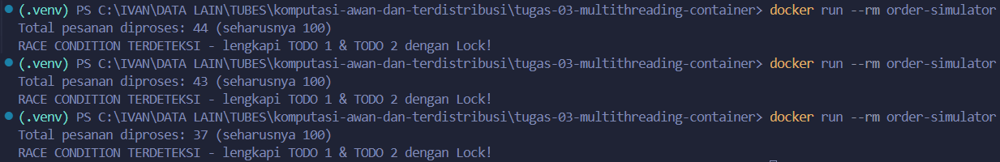
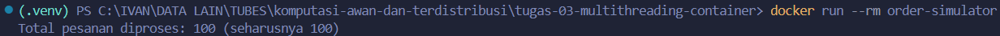

# Jurnal Proses — Tugas 3

## Percobaan tanpa Lock
- Hasil `processed_count` yang didapat: 


- Kenapa bisa meleset (jelaskan mekanisme race condition dengan kata sendiri):
<p align="justify">
Dari hasil percobaan yang diperoleh (seperti percobaan pertama (40 pesanan), percobaan kedua (39), dan percobaan ketiga (37 pesanan)), ketiganya menunjukkan hasil yang lebih rendah dari 100 pesanan sehingga memunculkan pesan <kbd>RACE CONDITION TERDETEKSI - lengkapi TODO 1 & TODO 2 dengan Lock!</kbd>. Ini terjadi karena adanya lost update yaitu dengan beberapa thread yang membaca nilai <kbd>processed_count</kbd> yang sama, kemudian ditimpa dengan pembaruan dari thread lainnya.
</p>
## Percobaan dengan Lock
- Hasil `processed_count` setelah perbaikan:

Dengan adanya Lock, kode yang dijalankan akan membaca dan memperbarui <kbd>processed_count</kbd> dengan satu thread pada satu waktu.

## Kendala Docker
- Error yang ditemui saat `docker build`/`docker run` dan cara memperbaikinya:
**Kasus &mdash; hypervisor tidak menyala atau off saat docker desktop jalan (pada <kbd>Windows</kbd>)**
1. Pertama cek dengan Powershell yang dijalankan menggunakan Run as administrator.
2. Lalu ketikkan perintah:
    ```powershell
    bcdedit /enum "{current}"
    ```
    Perintah ini digunakan untuk melihat apakah hypervisor sebenarnya sudah menyala atau belum (Boot Configuration Data Editor).
3. Jika hypervisor dalam keadaan off, ketikkan perintah:
    ```powershell
    bcdedit /set hypervisorlauchtype auto
    ```
    Perintah ini digunakan untuk mengaktifkan kembali hypervisor, setelahnya user harus melakukan restart pada perangkat (PC / laptop).
4. Kemudian coba jalankan perintah:
    ```vscode
    docker build -t order-simulator .
    ```
    Perintah ini digunakan untuk build proyek dari order_simulator.py yang ada pada direktori <kbd>tugas-03-multithreading-container</kbd>.

## Log Penggunaan AI (Level 2)

> Wajib diisi sesuai kebijakan Level 2 di [`../RUBRIK-UMUM.md`](../RUBRIK-UMUM.md). Tulis "Tidak memakai AI" pada baris pertama jika memang tidak dipakai. Hanya untuk brainstorming ide/outline — bukan untuk kode/analisis/teks akhir.

| Tanggal | Tool AI | Prompt yang diberikan | Ringkasan saran/ide AI | Bagaimana diolah jadi tulisan/kode sendiri |
|---|---|---|---|---|
| 20/10/2026 | chatgpt | Mengapa dalam pengujian ini membutuhkan Lock? | Tujuannya adalah agar jumlah pesanan yang berhasil diproses tercatat dengan benar, tanpa ada penambahan nilai akibat race condition. | Memahami tujuan dari pengujian pada tugas 3 multithreading dan menyesuaikan kode berdasarkan instruksi yang diberikan. |
|20/10/2026 | chatgpt | Apa fungsi dari Dockerfile? | Dockerfile berfungsi sebagai instruksi untuk Docker dalam membangun sebuah image, yaitu paket yang berisi aplikasi beserta lingkungan yang dibutuhkan agar aplikasi dapat dijalankan. | Memahami Dockerfile sebagai bagian yang diperlukan dalam melakukan build container dan menyesuaikan kode berdasarkan instruksi yang diberikan. |
| 20/10/2026 | chatgpt | Bagaimana cara mengatasi hypervisor yang tidak terdeteksi oleh docker desktop? | Berikut urutan pemeriksaan Windows 10/11 dan Docker Desktop: 1. Pastikan hypervisor aktif saat Windows dinyalakan. 2. Pastikan virtualisasi perangkat keras aktif. 3. Periksa fitur Windows untuk WSL 2. 4. Uji kembali Docker. | Menyesuaikan masalah yang terjadi sebagai salah satu kasus atau kendala pada tugas 3 multithreading |
