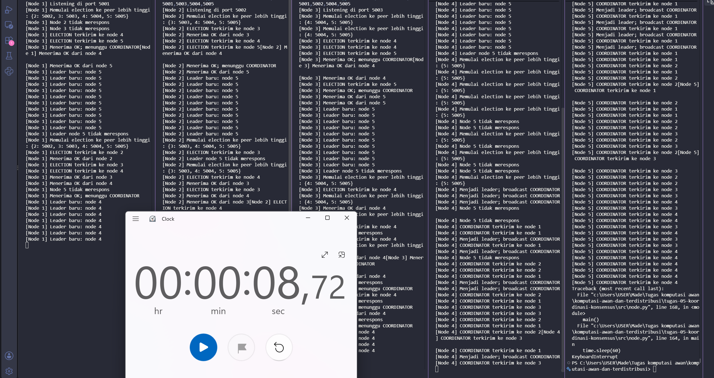

# Jurnal Proses — Tugas 5

## Implementasi Bully
- Kendala saat mengisi TODO 1-4: ...

## Skenario 1: Start normal
- Leader yang terpilih: Untuk Start awal, leader  yang terpilih adalah Node 5 karena idnya yang paling tinggi dari yang lain (node 1-4).
- Log/observasi:

## Skenario 2: Leader dimatikan
- Leader baru yang terpilih: saat node 5 diberhentikan (leader pertama mati), node 4 
- Berapa lama waktu sampai leader baru terdeteksi: berdasarkan gambar dibawah kurang lebih waktu yang diperlukan untuk memilih leader baru adalah 8,72 detik

## Log Penggunaan AI (Level 2)

> Wajib diisi sesuai kebijakan Level 2 di [`../RUBRIK-UMUM.md`](../RUBRIK-UMUM.md). Tulis "Tidak memakai AI" pada baris pertama jika memang tidak dipakai. Hanya untuk brainstorming ide/outline — bukan untuk kode/analisis/teks akhir.

| Tanggal | Tool AI | Prompt yang diberikan | Ringkasan saran/ide AI | Bagaimana diolah jadi tulisan/kode sendiri |
|---|---|---|---|---|
| 20/10/2026 | Gemini | jelaskan dan buatkan contoh untuk Aturan Bully Algorithm yang harus diimplementasikan Node yang mendeteksi leader tidak merespons (atau saat start pertama kali) mengirim pesan ELECTION ke semua node dengan ID lebih besar darinya. Jika ada node ber-ID lebih besar yang merespons OK, node yang memulai election berhenti mencalonkan diri dan menunggu pesan COORDINATOR. Jika tidak ada node ber-ID lebih besar yang merespons dalam batas waktu tertentu, node tersebut menjadi leader dan mem-broadcast COORDINATOR ke semua node lain. Semua node mencatat siapa leader saat ini. |Bully Algorithm adalah algoritma pemilihan pemimpin (leader election) pada sistem terdistribusi. Prinsip utamanya sangat sederhana: node dengan ID paling besar akan selalu "membully" (mengalahkan) node dengan ID lebih kecil untuk menjadi leader. Aturan Kerja Bully Algorithm Inisiasi Election: Ketika sebuah node mendeteksi leader mati (misal lewat mekanisme heartbeat timeout) atau saat baru pertama kali menyala, node tersebut akan mempublikasikan/mengirim pesan ELECTION ke semua node yang memiliki ID lebih besar darinya. |mencocokan contoh alur yang berikan dengan todo list yang ada di node.py|
|20/10/2026|gemini|election itu apa|Election (pemilihan ketua) adalah proses konsensus di mana node-node dalam sistem terdistribusi memilih satu node untuk menjadi Leader (Koordinator) yang bertugas mengorganisir tugas, mengelola state, atau mengkoordinasikan keputusan.|memahami|
